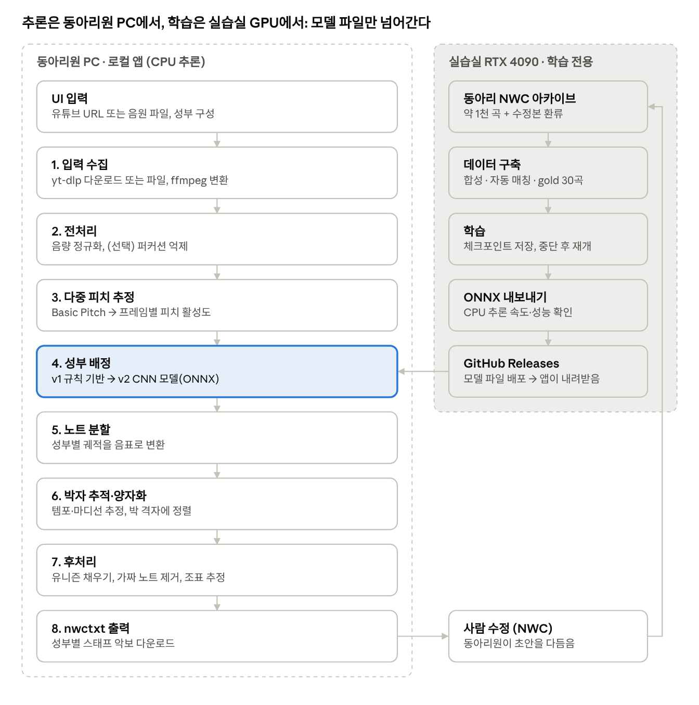
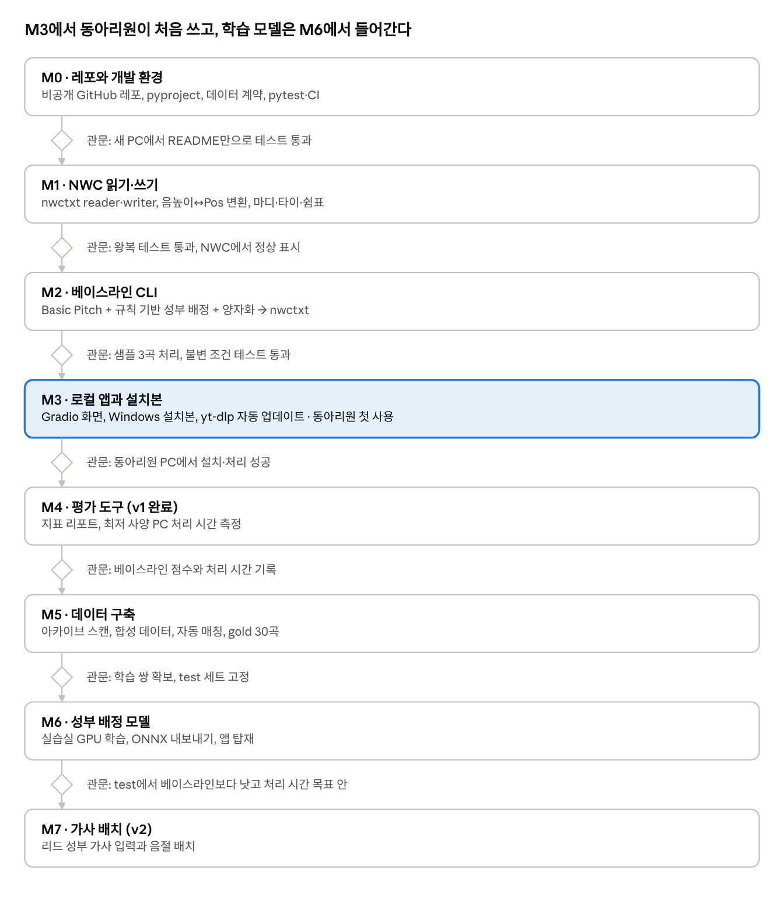

# 아카펠라 자동 채보 시스템 설계

Oct 27, 2026 · @YoungChan

## 개요

동아리원이 유튜브 URL(또는 음원 파일)과 성부 구성을 입력하면, 자기
PC에서 성부별 NWC 악보 초안(.nwctxt)을 받는 로컬 앱을 만든다. 사람은 이
초안을 NWC에서 고쳐 완성한다. 이 문서는 Claude Code가 그대로 따라 개발할
수 있는 단일 명세다.

- **사용자:** 동아리원. 내부 동작을 몰라도 URL과 성부만 넣으면 된다.

- **개발·운영:** 개발자 1인이 개발과 유지보수를 맡는다.

- **운영 제약:**

  - 서버, 회원 관리, 구독료가 없다.

  - 추론은 동아리원 PC의 CPU에서 한다.

  - RTX 4090(24GB)은 학교 실습실 PC라 언제든 끊길 수 있으므로 학습에만
    쓴다.

- **v1 범위:** 학습 없는 베이스라인 파이프라인, 로컬 UI, nwctxt 출력,
  평가 도구

- **v2 범위:** 학습된 성부 배정 모델(ONNX), 리드 성부 가사 입력과 배치

- **범위 밖:** 보이스 퍼커션 채보, 셈여림·슬러 같은 악상기호(편곡자가
  직접 입력), 가사 자동 인식

- **언어:** 음표 전사는 언어와 무관하므로 일본어·중국어 곡도 처리한다.
  가사 기능은 한국어와 영어를 우선 지원한다.

- **성공 기준:** 초안을 고쳐 완성하는 시간이 처음부터 따는 시간보다
  짧아야 한다. 목표 단축 비율은 동아리와 정한다.

## Claude Code 작업 지침

개발은 아래 원칙을 따른다. 이 문서는 레포의 docs/design.md에 사본으로
둔다.

1.  **마일스톤 순서대로 진행한다.** 각 마일스톤의 완료 기준을 테스트로
    확인한 뒤 다음으로 넘어간다.

2.  **위험한 작업은 먼저 알린다.** 되돌리기 어렵거나 동작 중인 기능을
    깨뜨릴 수 있는 작업은 실행 전에 무엇이 바뀌는지 설명하고 승인을
    받는다. 예: 파일 대량 삭제, force push 등 이력 재작성, 의존성 메이저
    업그레이드, 데이터 포맷이나 메타데이터 스키마 변경.

3.  **데이터는 커밋하지 않는다.** 동아리 nwc 악보, 음원, 다운로드한
    오디오, 모델 가중치는 레포에 올리지 않는다. data/, models/,
    outputs/는 .gitignore에 넣고, 모델 파일은 GitHub Releases로
    배포한다.

4.  **nwctxt 문법은 추측하지 않는다.** 실제 NWC에서 내보낸 파일을
    기준으로 삼아 테스트한다. 문법이 불명확하면 진행을 멈추고 질문한다.

5.  **데이터 계약을 지킨다.** 모든 모듈은 아래 '모듈 인터페이스와 데이터
    계약'의 타입을 따르고, 모듈마다 단위 테스트를 둔다.

6.  **추론은 CPU에서 돌아가야 한다.** GPU 전용 코드는 training/에만
    둔다. 앱 코드는 PyTorch에 의존하지 않는다.

7.  **대상 OS는 Windows다(확인 필요).** 경로는 pathlib로 다루고, ffmpeg
    같은 외부 실행 파일 경로는 설정으로 받는다.

8.  **학습은 중단을 전제로 짠다.** 체크포인트를 주기적으로 저장하고,
    마지막 체크포인트부터 재개할 수 있어야 한다.

9.  **모호하면 가정을 기록한다.** 명세에 없는 사소한 결정은 가정을
    README나 커밋 메시지에 적고 진행한다. 사용자 경험이나 데이터 포맷에
    영향을 주는 결정은 질문한다.

## 시스템 아키텍처

시스템 구성 · 로컬 추론 8단계와 학습·배포 흐름

동아리원 PC는 학습된 모델 파일만 내려받아 CPU로 추론하므로, 실습실
4090이 꺼져도 앱은 영향을 받지 않는다. 서버와 인증은 없다. 각 단계는
같은 인터페이스를 유지한 채 v2에서 구현만 교체한다.

| 단계                 | 모듈           | v1 구현                                                                               | v2 교체                                  |
|----------------------|----------------|---------------------------------------------------------------------------------------|------------------------------------------|
| 1\. 입력 수집        | ingest.py      | yt-dlp로 오디오 추출, 또는 파일 입력. ffmpeg로 모노 WAV 변환                          | 변경 없음                                |
| 2\. 전처리           | preprocess.py  | 음량 정규화                                                                           | 보컬 퍼커션 억제(선택)                   |
| 3\. 다중 피치 추정   | pitch.py       | Basic Pitch(노트 후보와 프레임별 피치 활성도)                                         | 합창 특화 모델 또는 Basic Pitch 파인튜닝 |
| 4\. 성부 배정        | voices.py      | 규칙 기반: 프레임별 음높이 순위 + 연속성 비용(Viterbi) + 사용자 음역 제약             | 학습된 CNN 모델(ONNX Runtime)            |
| 5\. 노트 분할        | notes.py       | 성부별 궤적을 음표로 변환(최소 길이, 음높이 변화 기준)                                | 변경 없음                                |
| 6\. 박자 추적·양자화 | rhythm.py      | librosa 비트 추적 후 16분음표 격자에 정렬. 정확도가 부족하면 다른 비트 추적 도구 비교 | 학습 기반 양자화 검토                    |
| 7\. 후처리           | postprocess.py | 유니즌 채우기, 짧은 가짜 노트 제거, 조표 추정                                         | 규칙 보강                                |
| 8\. 출력             | nwc/writer.py  | 성부별 스태프 nwctxt 생성                                                             | 리드 성부 가사 배치                      |

## 저장소 구조와 기술 스택

앱 코드(src/)와 개발자 전용 도구(tools/, training/, eval/)를 분리한다.
동아리원에게 배포되는 것은 src/와 모델 파일뿐이다.

- **언어:** Python. 버전은 Basic Pitch와 ONNX Runtime이 함께 지원하는
  버전으로 고정한다(확인 필요).

- **의존성 관리:** pyproject.toml + uv

- **UI:** Gradio. 로컬(127.0.0.1)에서 실행하고 브라우저를 자동으로 연다.

- **추론:** Basic Pitch, ONNX Runtime(CPU), numpy, librosa

- **음원 입력:** yt-dlp, ffmpeg(설치본에 포함)

- **학습:** PyTorch(실습실 PC의 training/에서만 사용)

- **평가:** mir_eval

- **품질:** pytest, ruff, GitHub Actions CI

- **패키징:** Windows 설치본. 도구는 M3에서 PyInstaller와 임베디드
  Python 방식을 비교해 정한다.

acappella-transcriber/  
├─ README.md  
├─ pyproject.toml  
├─ .gitignore \# data/, models/, outputs/, 음원, nwc 제외  
├─ docs/  
│ └─ design.md \# 이 문서의 사본  
├─ src/acappella/  
│ ├─ types.py \# 데이터 계약  
│ ├─ config.py \# 경로, 성부 프리셋, 임계값  
│ ├─ app/  
│ │ └─ ui.py \# Gradio UI, 실행 진입점  
│ ├─ pipeline/  
│ │ ├─ ingest.py \# yt-dlp, 파일 입력, ffmpeg 변환  
│ │ ├─ preprocess.py  
│ │ ├─ pitch.py \# Basic Pitch 래퍼  
│ │ ├─ voices.py \# 성부 배정(규칙 / ONNX)  
│ │ ├─ notes.py \# 노트 분할  
│ │ ├─ rhythm.py \# 비트 추적, 양자화, 박자표  
│ │ ├─ postprocess.py  
│ │ └─ run.py \# transcribe() 오케스트레이션, CLI  
│ └─ nwc/  
│ ├─ writer.py \# Score → nwctxt  
│ ├─ reader.py \# nwctxt → Score(데이터 구축·평가용)  
│ └─ pitch_pos.py \# 음높이 ↔ Pos, 조표·임시표  
├─ tools/ \# 개발자 전용  
│ ├─ scan_archive.py  
│ ├─ extract_nwctxt.py  
│ ├─ match_youtube.py  
│ ├─ align.py  
│ └─ build_dataset.py  
├─ training/ \# 실습실 GPU에서만 실행  
│ ├─ synth.py \# 악보 → 합성 학습 데이터  
│ ├─ dataset.py  
│ ├─ model.py  
│ ├─ train.py \# 체크포인트·재개 지원  
│ └─ export_onnx.py  
├─ eval/  
│ ├─ metrics.py \# mir_eval 래퍼, 리듬 일치율  
│ └─ run_eval.py  
├─ tests/  
│ └─ fixtures/ \# 저작권 문제가 없는 짧은 예시만  
└─ packaging/ \# Windows 설치본 스크립트

## 모듈 인터페이스와 데이터 계약

모듈은 아래 타입만 주고받는다. 입력 수집을 빼면 모두 순수 함수로 만들고,
디버깅을 위해 단계별 출력을 outputs/\<작업 ID\>/에 저장할 수 있게 한다.
필드는 출발점이며, 바꿀 때는 지침 2번대로 먼저 알린다.

\# src/acappella/types.py  
from dataclasses import dataclass, field  
from fractions import Fraction  
import numpy as np  
  
@dataclass  
class VoiceSpec:  
name: str \# "S1", "S2", "A", "T", "B", "Lead" 등  
clef: str \# "treble" \| "treble8vb" \| "bass"  
low_midi: int \# 대략 음역 하한(MIDI 번호)  
high_midi: int \# 대략 음역 상한  
  
@dataclass  
class AudioClip:  
samples: np.ndarray \# 모노 float32  
sr: int  
source: str \# URL 또는 파일 경로  
title: str = ""  
  
@dataclass  
class NoteEvent:  
onset: float \# 초  
offset: float \# 초  
midi: int  
confidence: float = 1.0  
  
@dataclass  
class PitchActivation: \# 다중 피치 추정 출력  
times: np.ndarray \# (T,) 프레임 시각, 초  
midi_bins: np.ndarray \# (F,) 각 주파수 빈의 MIDI 음높이  
salience: np.ndarray \# (T, F) 0~1  
notes: list\[NoteEvent\] = field(default_factory=list)  
  
@dataclass  
class VoiceTrack:  
voice: VoiceSpec  
times: np.ndarray \# (T,)  
f0_midi: np.ndarray \# (T,) 프레임별 음높이, 무음은 nan  
  
@dataclass  
class QNote: \# 양자화된 음표  
start_beat: Fraction \# 곡 시작부터의 박 위치  
dur_beats: Fraction  
midi: int \| None \# None이면 쉼표  
tie_next: bool = False  
lyric: str \| None = None  
  
@dataclass  
class Score:  
title: str  
tempo_bpm: float  
time_sig: tuple\[int, int\] \# (4, 4)  
key_fifths: int \# -7(플랫 7개) ~ +7(샵 7개)  
voices: list\[VoiceSpec\]  
parts: dict\[str, list\[QNote\]\] \# 성부 이름 → 음표 열

\# 파이프라인 함수 시그니처  
def ingest(source: str, workdir: Path) -\> AudioClip  
def preprocess(clip: AudioClip) -\> AudioClip  
def estimate_pitch(clip: AudioClip) -\> PitchActivation  
def assign_voices(act: PitchActivation, voices: list\[VoiceSpec\]) -\>
list\[VoiceTrack\]  
def segment_notes(tracks: list\[VoiceTrack\]) -\> dict\[str,
list\[NoteEvent\]\]  
def quantize(notes: dict\[str, list\[NoteEvent\]\], clip: AudioClip) -\>
Score  
def postprocess(score: Score) -\> Score  
def write_nwctxt(score: Score, path: Path) -\> Path  
def transcribe(source: str, voices: list\[VoiceSpec\], out_dir: Path,  
progress: Callable\[\[str, float\], None\] \| None = None) -\> Path

**불변 조건(테스트로 검증):**

- 각 성부는 단선율이다. 한 성부 안에서 음표가 겹치지 않는다.

- 모든 마디의 음표와 쉼표 길이 합은 박자표와 같다.

- 음표는 성부의 음역 밖으로 크게 벗어나지 않는다. 벗어나면 경고를 로그에
  남긴다.

- 같은 입력과 같은 설정이면 같은 출력이 나온다.

## NWC 출력 명세

MIDI를 거치지 않고 nwctxt를 직접 생성한다. NWC의 MIDI 가져오기에서
생기는 성부 중복과 타이 문제를 피하고, 성부별 단선율을 구조적으로
보장하기 위해서다. NWC 2.75 이상은 nwctxt 파일을 읽고 쓸 수 있다.

- **파일:** UTF-8 텍스트 .nwctxt. 동아리에서 쓰는 NWC 버전 확인이
  필요하다.

- **스태프:** 성부 하나에 스태프 하나. 스태프 이름은 성부 이름. 화음을
  쓰지 않는다.

- **음자리표 기본값:** S·A·Lead는 높은음자리표, T는 옥타브 아래
  높은음자리표, B는 낮은음자리표. 사용자가 바꿀 수 있다.

- **첫 마디:** 조표, 박자표, 템포를 넣는다.

- **음높이:** MIDI 번호를 음자리표 기준 위치(Pos)로 바꾼다. 조표에 없는
  음은 임시표를 붙이고, 이명동음은 조성에 맞춰 고른다(pitch_pos.py).

- **음가:** 온·2분·4분·8분·16분음표와 점음표. 마디를 넘는 음은 타이로
  나눈다. 셋잇단음표는 v1에서 쓰지 않는다.

- **쉼표:** 빈 구간을 쉼표로 채워 모든 마디 길이를 맞춘다.

- **가사(v2):** 리드 스태프에 Lyric1로 넣는다. NWC는 슬러나 타이로
  이어진 음에 음절을 붙이지 않고, 건너뛸 자리는 공백으로 둘러싼
  밑줄(\_)로 표시한다.

아래는 구조를 보여주는 예시다. 정확한 문법은 실제 동아리 파일을 내보낸
결과로 확정한다.

!NoteWorthyComposer(2.75)  
\|SongInfo\|Title:"곡 제목"  
\|AddStaff\|Name:"S1"  
\|Clef\|Type:Treble  
\|Key\|Signature:F#  
\|TimeSig\|Signature:4/4  
\|Tempo\|Tempo:92  
\|Note\|Dur:4th\|Pos:-2  
\|Note\|Dur:4th,Dotted\|Pos:0  
\|Note\|Dur:8th\|Pos:1^  
\|Bar  
\|Note\|Dur:Half\|Pos:1  
\|Rest\|Dur:Half  
\|Bar  
\|AddStaff\|Name:"A"  
...  
!NoteWorthyComposer-End

**검증 방법:**

1.  **왕복 테스트:** 실제 동아리 nwctxt를 reader로 읽고 writer로 다시 쓴
    뒤, 다시 읽은 결과가 원본과 같은지 비교한다.

2.  **구조 테스트:** 단선율, 마디 길이, 음역 불변 조건을 생성 파일마다
    검사한다.

3.  **수동 확인:** 마일스톤마다 개발자가 생성 파일을 NWC에서 열어 깨짐
    없이 표시되는지 확인한다.

## 데이터 파이프라인

동아리 아카이브(약 1천 곡, 약 4GB, 출처 영상 미상 곡 약 절반)를 세 층의
데이터로 만든다. 1천 곡 전부를 손으로 매핑하지 않고, 사람이 확인하는
것은 gold 약 30곡뿐이다. 데이터는 개발자 PC와 실습실 PC에만 두고 레포에
올리지 않는다.

1.  **아카이브 스캔** (tools/scan_archive.py): 확장자별 개수와 용량, nwc
    버전, 파일명이나 곡 정보에 남은 제목·링크를
    data/meta/archive_index.csv로 정리한다. 파트별 연습 음원이 있으면
    따로 표시한다.

2.  **nwctxt 추출** (tools/extract_nwctxt.py): NWC 포럼에 따르면 2.75
    이상에서 저장한 .nwc 파일에는 nwctxt가 들어 있다. 추출이 되는지 먼저
    검증하고, 실패한 파일은 목록으로 남겨 NWC에서 일괄 내보내는 방법을
    따로 찾는다.

3.  **층 A, 합성 데이터** (training/synth.py): 전 곡의 악보를 성부별로
    합성 음성으로 렌더링해, 정렬이 완벽한 학습 쌍을 만든다. 렌더링
    방식(하모닉 합성, 샘플 기반, 노래 합성)은 M5에서 비교해 정한다. 다른
    곡의 성부를 조합하고 템포와 음높이를 바꾸는 곡간 믹싱 증강도
    시험한다.

4.  **층 B, 자동 매칭(silver)** (tools/match_youtube.py,
    tools/align.py):

    - 곡 제목으로 유튜브 후보 영상을 몇 개 찾는다.

    - 각 후보 오디오와 악보 MIDI의 크로마 특징을 DTW로 정렬한다.
      조옮김은 반음 이동 12가지 중 비용이 가장 낮은 것으로 감지한다.

    - 비용이 임계값보다 낮으면 자동 승인하고, 애매하면 검토 목록에
      넣는다. 임계값은 gold 곡으로 정한다.

5.  **층 C, gold** : 사람이 링크, 악보 일치, 시간 정렬을 직접 확인한 약
    30곡. 4성부와 5~6성부, 장르를 고르게 섞고 메들리는 넣지 않는다.
    평가(valid/test) 전용이다.

6.  **태그:** 메들리, 조옮김, 편곡 차이, 가사 언어를 메타데이터에
    기록한다. 메들리는 곡 단위 구간으로 나누거나 따로 평가한다.

곡마다 메타데이터 파일을 둔다.

{  
"song_id": "s0001",  
"title": "곡 제목",  
"nwc_path": "data/nwc/s0001.nwc",  
"youtube_url": "https://...",  
"tier": "A \| B \| C",  
"voices": \["Lead", "S", "A", "T", "B"\],  
"transpose_semitones": 0,  
"align_cost": 0.12,  
"is_medley": false,  
"lyrics_lang": "ko",  
"group": "원곡 또는 커버 채널",  
"split": "train \| valid \| test"  
}

## 모델 학습 (v2)

학습 대상은 성부 배정 모델 하나이고, 실습실 4090에서만 학습한다.
베이스라인(v1)의 평가 결과가 나온 뒤 시작한다.

- **모델:** 작은 CNN으로 시작한다. 입력은 피치 활성도(T×F) 구간과 성부
  수 N, 성부별 음역이다. 출력은 최대 K=8개 슬롯 × 프레임의 음높이 분포와
  활성 여부이며, 슬롯은 음높이 순서를 따른다. 구조는 Cuesta & Gómez의
  공개 코드를 참고한다. 트랜스포머는 베이스라인 이후 비교 실험 후보로만
  둔다.

- **분할:** 곡 단위로 나누고, 같은 곡의 합성본과 실제본은 같은 쪽에
  둔다. 평가는 처음 보는 그룹에 대한 성능이어야 하므로 그룹(원곡·커버
  채널) 단위로도 겹치지 않게 한다.

- **세 세트의 역할:**

  - **train:** 가중치를 갱신하는 유일한 데이터. 사전학습과 파인튜닝 모두
    train으로만 학습한다.

  - **valid:** 학습 중 성능을 재서 조기 종료 시점, 체크포인트, 학습률 등
    설정을 고른다. 가중치 갱신에는 쓰지 않는다.

  - **test:** 모든 선택을 마친 뒤 마지막에 한 번만 잰다. test 결과를
    보고 설정을 고치지 않는다.

- **단계:**

  1.  사전학습: 층 A 합성 데이터와 공개 데이터(Cuesta 합성셋 등).
      train/valid 모두 합성 데이터에서 나눈다.

  2.  파인튜닝: 층 B 실제 데이터로 낮은 학습률을 쓰고 앞단 층은
      고정한다. valid는 층 B 일부 또는 층 C 일부로 한다.

  3.  최종 평가: 층 C의 test 곡으로 한 번 측정한다.

- **증강:** ±2반음 피치 시프트, 템포 변화, 성부별 음량 비율, 리버브,
  비트박스 잡음 혼합, 곡간 성부 조합

- **중단 대비:** 일정 간격으로 체크포인트를 저장하고 train.py
  --resume으로 마지막 지점부터 재개한다. 데이터와 체크포인트는 실습실 PC
  밖에도 백업한다.

- **배포:** export_onnx.py로 ONNX 파일을 만들고, CPU 추론 속도와 test
  성능이 베이스라인보다 나을 때만 GitHub Releases에 올린다.

## 평가 체계

최종 판단 기준은 사람이 초안을 고치는 수고이고, 표준 지표는 어느 모듈이
병목인지 찾는 데 쓴다. eval/run_eval.py는 gold 곡을 돌려 아래 지표를 한
리포트로 낸다.

| 지표                      | 무엇을 보나                  | 측정 방법                                                   |
|---------------------------|------------------------------|-------------------------------------------------------------|
| 수정 시간, 수정 음표 수   | 실사용 효용                  | 같은 곡을 처음부터 딸 때와 초안을 고칠 때를 동아리원이 비교 |
| 곡당 처리 시간            | CPU 추론 실용성              | 동아리원 최저 사양 PC에서 측정                              |
| 노트 F1 (onset 허용 오차) | 음표 단위 정확도             | mir_eval transcription                                      |
| 성부별 피치 정확도        | 성부 배정 품질, 성부 간 혼동 | 성부별 궤적에 mir_eval melody 지표 적용                     |
| 프레임 다중 피치 정확도   | 피치 추정 품질               | mir_eval multipitch                                         |
| 리듬 일치율               | 양자화 후 박 위치            | 정답 악보와 출력을 비교하는 자체 스크립트                   |

test 세트에는 4성부와 5~6성부 곡, 디비지가 많은 곡, 여러 장르를 고루
넣는다. 성부 수와 장르별 점수를 따로 보고한다.

## 배포와 로컬 앱

동아리원에게는 설치형 로컬 앱을 배포한다. 실행하면 브라우저에 로컬
화면(127.0.0.1)이 열리고, 모든 처리가 그 PC 안에서 끝난다. 외부 서버와
로그인은 없다.

- **입력 화면:**

  - 유튜브 URL, 또는 음원 파일 업로드(mp3, wav, m4a)

  - 성부 구성: 프리셋(SATB, SSATB, Lead+SATB, Lead+SSATTB)과 직접 추가.
    성부마다 음자리표와 음역 기본값이 채워지고 수정할 수 있다.

  - 곡 제목, 박자표(기본값은 자동 추정)

  - (v2) 리드 성부 가사

- **출력 화면:** 단계별 진행률, .nwctxt 다운로드, 검토용 성부별
  MIDI(선택). 오류는 "영상을 받을 수 없습니다. 음원 파일로 시도해
  주세요"처럼 다음 행동을 알려준다.

- **설치본 구성:** Python 런타임, 앱 코드, ffmpeg, yt-dlp, ONNX 모델
  파일. PyTorch는 넣지 않는다.

- **업데이트:**

  - 앱과 모델은 GitHub Releases의 버전 태그로 배포하고, 앱이 실행될 때
    새 버전이 있으면 알려준다.

  - yt-dlp는 유튜브 변경에 맞춰 자주 갱신되므로 실행할 때 업데이트를
    시도한다. 실패해도 파일 입력은 동작해야 한다.

- **음원 보관:** 다운로드한 음원은 처리 후 삭제하는 것을 기본값으로
  한다.

- **사용 범위:** 동아리 내부용으로 한정한다. 유튜브 다운로드는 서비스
  약관과 충돌할 수 있으므로 공개 배포하지 않는다.

- **성능 목표:** 동아리원 최저 사양 PC에서 곡당 처리 시간 목표를
  정하고(열린 질문), M4에서 측정한다.

## 개발 마일스톤

개발 마일스톤 · M0~M7과 관문

v1(M0~M4)을 먼저 완성해 동아리원이 쓰게 하고, 학습(M5~M6)은 그 뒤에
한다. M5의 아카이브 스캔은 M1과 함께 시작해도 된다.

**M0. 레포와 개발 환경**

- [ ] 비공개 GitHub 레포, pyproject.toml, .gitignore, README 실행법

- [ ] 위 디렉터리 구조와 types.py 데이터 계약 생성

- [ ] pytest, ruff, GitHub Actions CI

<!-- -->

- 완료 기준: 새 PC에서 README만 보고 테스트가 통과한다.

**M1. NWC 읽기·쓰기**

- [ ] 개발자가 동아리 nwctxt 예시 2~3개를 tests/fixtures/에 제공(외부
  공유 금지 파일이면 로컬 전용 테스트로 분리)

- [ ] reader.py, writer.py, pitch_pos.py(조표, 임시표, 음자리표별 Pos)

- [ ] 마디 분할, 타이, 쉼표 채우기

<!-- -->

- 완료 기준: 왕복 테스트 통과, 생성 파일이 NWC에서 정상 표시된다.

**M2. 베이스라인 CLI**

- [ ] ingest(yt-dlp, 파일), preprocess, estimate_pitch(Basic Pitch)

- [ ] 규칙 기반 assign_voices, segment_notes, quantize, postprocess

- [ ] acappella transcribe \<URL 또는 파일\> --voices Lead,S,A,T,B 명령

<!-- -->

- 완료 기준: 샘플 3곡이 끝까지 처리되고 불변 조건 테스트를 통과한다.

**M3. 로컬 앱과 설치본**

- [ ] Gradio 입력·출력 화면, 진행률, 쉬운 오류 메시지

- [ ] Windows 설치본, yt-dlp 자동 업데이트, 새 버전 알림

<!-- -->

- 완료 기준: 동아리원 1~2명이 자기 PC에 설치해 한 곡을 처리한다.

**M4. 평가 도구 (v1 완료)**

- [ ] eval/run_eval.py로 지표 리포트

- [ ] 최저 사양 PC 처리 시간 측정

<!-- -->

- 완료 기준: gold 일부로 베이스라인 점수와 처리 시간이 기록된다.

**M5. 데이터 구축**

- [ ] 아카이브 스캔, nwctxt 추출

- [ ] 층 A 합성 데이터, 층 B 자동 매칭과 정렬, 검토 목록

- [ ] 층 C gold 30곡 확정, 곡·그룹 단위 분할

<!-- -->

- 완료 기준: 메타데이터가 채워진 학습 쌍과 고정된 test 세트가 있다.

**M6. 성부 배정 모델**

- [ ] 사전학습, 파인튜닝(체크포인트·재개)

- [ ] ONNX 내보내기와 앱 탑재, 규칙 기반과 전환 가능하게

<!-- -->

- 완료 기준: test에서 베이스라인보다 낫고, CPU 처리 시간이 목표 안이다.

**M7. 가사 배치 (v2)**

- [ ] 가사 입력 칸, 한국어·영어 음절 분할, 리드 스태프 Lyric1 생성

<!-- -->

- 완료 기준: 가사가 NWC에서 음표 아래 올바르게 정렬된다.

## 리스크

| 리스크                                             | 영향                       | 대응                                                    |
|----------------------------------------------------|----------------------------|---------------------------------------------------------|
| 알토·테너처럼 음역이 겹치는 성부 혼동              | 안쪽 성부 수정량 증가      | 사용자 음역 제약, 동아리 데이터 파인튜닝                |
| 유니즌·디비지에서 피치가 하나만 검출됨             | 성부 누락                  | 검출 수가 N보다 적으면 인접 성부 유니즌으로 채우는 규칙 |
| 리듬 양자화 오류                                   | 박자가 틀어진 악보         | 비트 추적 도구 비교, 템포·박자표 수동 입력 옵션         |
| 동아리원 PC가 느림                                 | 처리 시간이 길어 사용 포기 | M4에서 측정, 모델 경량화, 진행률 표시                   |
| 유튜브 변경으로 yt-dlp가 깨짐                      | URL 입력 실패              | 실행 시 자동 업데이트, 음원 파일 입력 대안              |
| 서명 없는 설치 파일의 Windows 보안 경고, 큰 설치본 | 설치 거부감                | PyTorch 제외, 설치 안내 문서                            |
| 실습실 PC 중단                                     | 학습 지연                  | 체크포인트·재개, 외부 백업                              |
| 악보와 원곡 불일치(조옮김·편곡)                    | 잘못된 학습 라벨           | 정렬 비용 필터, 조옮김 자동 감지                        |
| 리버브·이펙트가 강한 음원                          | 피치 추정 오류             | 리버브 증강, 저품질 음원 표시                           |
| 유튜브 약관·저작권                                 | 공개 배포 제한             | 동아리 내부 한정, 데이터와 음원은 레포에 넣지 않음      |

## 열린 질문

개발 전에, 또는 해당 마일스톤 전에 개발자가 답한다.

- [ ] 동아리원 PC의 OS(Windows 또는 Mac)와 최저 사양은? (M0 전)

- [ ] 동아리에서 쓰는 NWC 버전이 2.75 이상인가? nwctxt 추출 가능 여부가
  달라진다. (M1 전)

- [ ] 곡당 처리 시간 목표는 몇 분인가? (M3 전)

- [ ] 성공 기준의 목표 단축 비율은? (M4 전)

- [ ] 아카이브 4GB의 구성(nwc 외에 녹음, 파트별 연습 음원이 있는가)은?
  (M5 전)

- [ ] Cuesta 합성셋, jaCappella 등 공개 데이터의 사용 조건은? (M6 전)

## 참고문헌

- [Cuesta & Gómez, Voice Assignment in Vocal Quartets Using Deep
  Learning Models Based on Pitch Salience (TISMIR
  2022)](https://dx.doi.org/10.5334/tismir.121) ·
  [코드](https://github.com/helenacuesta/voas-vocal-quartets)

- [Cuesta, Data-driven Pitch Content Description of Choral Singing
  Recordings (박사학위논문, 2022)](https://zenodo.org/records/6389643)

- [Nakamura et al., jaCappella Corpus: A Japanese A Cappella Vocal
  Ensemble Corpus (arXiv 2211.16028)](https://arxiv.org/abs/2211.16028)

- [Spotify Basic Pitch](https://github.com/spotify/basic-pitch) · [소개
  글](https://engineering.atspotify.com/meet-basic-pitch/)

- [Gardner et al., MT3: Multi-Task Multitrack Music Transcription (ICLR
  2022)](https://arxiv.org/abs/2111.03017v4)

- [Duan, Han, Pardo, Song-level Multi-pitch Tracking by Heavily
  Constrained Clustering (ICASSP
  2010)](https://users.cs.northwestern.edu/~jha222/paper/2010_ICASSP_DuanHanPardo.pdf)

- [NoteWorthy Composer 지원 파일
  형식](https://noteworthycomposer.com/faq/32.md) · [nwctxt 파일
  다루기(포럼)](https://forum.noteworthycomposer.com/?msg=40454) · [가사
  입력 규칙](https://noteworthycomposer.com/hh/nwc1/MNU_EDITLYRICS.htm)

- [yt-dlp](https://github.com/yt-dlp/yt-dlp)
